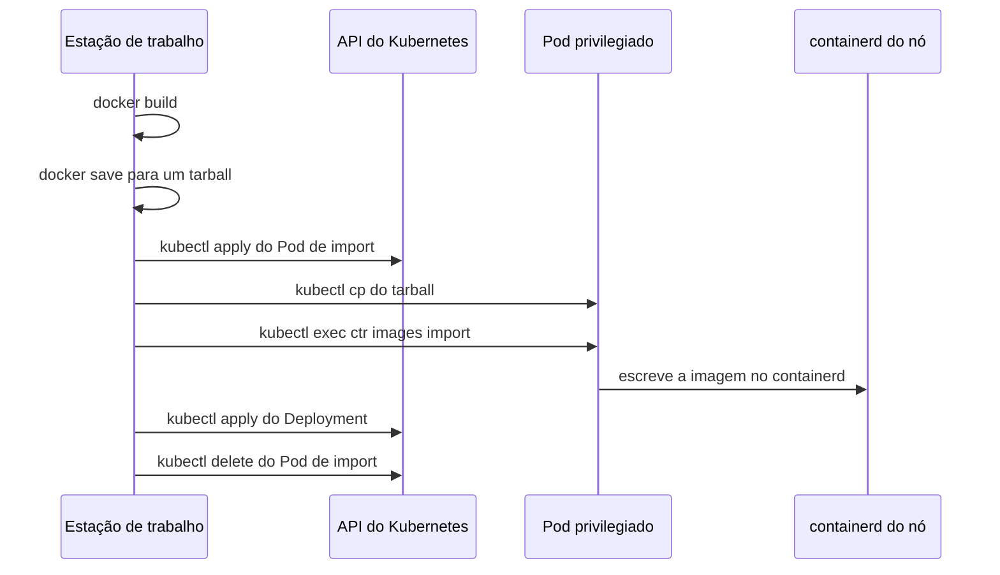
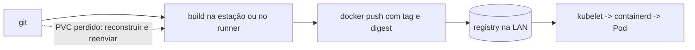

# Do `docker save` ao `docker push`: imagens OCI sem privilégio no nó

Durante meses, publicar uma imagem no meu homelab foi um ritual de seis passos.

Construir. Salvar num tarball. Subir um Pod temporário com `hostPath` no socket do containerd. Copiar o tarball para dentro do Pod. Executar `ctr images import`. Só então aplicar o Deployment — e torcer para o `trap` de limpeza não ter falhado.

Funcionava. E foi justamente por funcionar que demorei tanto para olhar para o que ele realmente era.

## O ritual, passo a passo



Cinco saltos para mover bytes que já estavam num registry público ou num diretório local. Nenhum deles relacionado ao que eu queria fazer, que era simplesmente *declarar que essa imagem deveria rodar*.

## Eu ainda tinha esse ritual no repositório

Antes de criticar o fluxo, vale a confissão: ele continua aqui.

O `scripts/otel-go-demo.sh` faz `docker build`, `docker save` e `sudo k3s ctr images import`. Os dois Deployments da aplicação de demonstração usam:

```yaml
image: guiosoft/otel-go-demo:dev
imagePullPolicy: Never
```

Esse `Never` é a confissão do sistema. Um manifesto que precisa dizer ao kubelet "não tente buscar esta imagem" está admitindo que a imagem chegou ali por fora — que alguém a colocou no nó manualmente. O cluster a executa, mas não sabe de onde ela veio, nem qual é a sua identidade, nem quando ela pode ser descartada.

## Os três problemas reais

O primeiro é o mais óbvio e o mais grave: **o socket do containerd é equivalente a root no nó**. Qualquer Pod que o monte pode importar, substituir ou apagar imagens. Eu tinha um caminho de execução de código arbitrário aberto permanentemente, cuja única justificativa era transportar um arquivo.

O segundo é mais sutil: **a imagem ficava presente, mas não declarada**. Sem digest, sem política de pull, sem relação com o ciclo de vida do workload. O kubelet não sabia como aquela imagem chegou. E o que não está declarado não é reproduzível: reinstalar o nó, trocar de máquina ou reconstruir o cluster produz um estado diferente do que existe hoje.

O terceiro é o que mais me incomodou depois: **o fluxo dependia de acesso ao nó**. Não dava para publicar de outra máquina da LAN, nem de um script no CI, nem do notebook de outra pessoa. O caminho crítico de deploy passava por um `sudo` que só existia naquela máquina.

## O que muda quando a imagem é declarada

Com um registry OCI dentro da LAN, o push vira:

```bash
TAG="registry.guiosoft.info/app/api:k3s-$(date +%Y%m%d%H%M%S)"
docker build -t "$TAG" .
docker push "$TAG"
```

A imagem passa a ter endereço e digest. O transporte é feito pelo próprio cluster — kubelet conversa com o containerd, que conversa com o registry. A única credencial envolvida é um `imagePullSecrets` no namespace do workload. Nenhum Pod privilegiado, nenhum `hostPath`, nenhum acesso ao nó.

```yaml
spec:
  imagePullSecrets:
    - name: registry-pull
  containers:
    - name: api
      image: registry.guiosoft.info/app/api:k3s-20261106094625
```

O ganho não é estético. É que **o deploy deixou de precisar de root**. E um passo que não precisa de root pode ser executado por qualquer coisa: uma pessoa, um script, um runner.

## A objeção que eu tinha: e se eu perder o registry?

Essa foi a pergunta que me travou por mais tempo.

O registry roda num PVC de 20Gi. Se esse volume for perdido, corrompido ou recriado, as imagens vão embora. A resposta que eu precisava aceitar é:

**o registry é cache, não fonte de verdade.**



Toda imagem nele é reconstruível a partir do git. Nenhum estado do cluster depende do seu conteúdo. Pods já em execução não são afetados por uma perda do PVC, porque a imagem deles já está no cache do containerd do nó.

Isso tem consequências concretas, e são elas que tornam a propriedade real em vez de uma frase bonita:

- o diretório do PVC do registry é **excluído do snapshot de PVs**, com a exclusão calculada em runtime a partir do `claimRef` vivo — então ela sobrevive a um reprovisionamento, quando o diretório `pvc-<uuid>` muda de nome;
- o preflight de DR **falha** se aparecer qualquer PV do namespace `registry` no recovery set;
- se o PVC for recriado, o Flux reconcilia o registry vazio e o ciclo recomeça no próximo push.

A distinção que eu passei a usar: *backup* responde "o que eu não consigo reconstruir"; *registry* responde "o que eu quero mover rápido". Misturar as duas coisas é como um cache vira dependência.

## Três armadilhas que custaram tempo de verdade

### O 404 que parecia problema de autenticação

Sintoma: `docker push` falhava com `404 page not found`. `docker login` também. Mas a mesma URL, forçada para o IP interno do nó, respondia `401` — o registry estava lá.

Causa: a estação resolvia o hostname pelo DNS público, caía no Cloudflare Tunnel, e o Tunnel entregava a requisição ao Traefik na porta 80. O Ingress do registry estava pinado ao entrypoint `websecure` — pin esse que eu tinha colocado justamente como segunda camada de bloqueio público. Resultado: na porta 80 não existia rota, e o Traefik respondia `404` antes de qualquer coisa relacionada a credencial.

O que tornou isso confuso foi esse `401`: ele parece "sua senha está errada", então eu fui depurar senha, htpasswd, Secret — enquanto o problema era rota.

A correção não foi no registry: foi uma entrada de split-DNS no roteador da LAN, apontando o hostname para o IP interno do nó.

A lição que eu levo: **num registry, `404` quase nunca significa "caminho errado"**. Significa "você não chegou ao registry".

### O `configs` que o containerd ignorou em silêncio

O nó precisava confiar no certificado autoassinado do Traefik. Escrevi o `registries.yaml` com o bloco de TLS aninhado dentro de `config:`, que é o formato que eu tinha inferido de exemplos.

O k3s subiu sem erro. O arquivo estava no lugar, com as permissões certas. E o pull por Pod continuava falhando com erro de TLS.

O containerd simplesmente ignorou a chave aninhada. Sem aviso, sem log, sem exit code. A estrutura correta usa `configs` no nível superior:

```yaml
configs:
  "registry.guiosoft.info":
    tls:
      insecure_skip_verify: true
```

A lição: **configuração que falha em silêncio é pior que configuração que falha alto**. E a única verificação que vale é comportamental — um pull real de dentro de um Pod, não "o serviço subiu" nem "o arquivo existe".

### O certificado que o Docker não confiava

Sintoma: `docker push` falhava com erro de TLS (`x509: certificate signed by unknown authority`), mesmo com o hostname resolvendo corretamente para o IP interno. `docker login` também falhava.

Causa: o Traefik usa o certificado autoassinado padrão. O containerd do nó confia nele via `insecure_skip_verify` no `registries.yaml`, mas o daemon Docker é um processo separado com sua própria configuração de TLS. O daemon Docker do nó não tinha `/etc/docker/daemon.json` — logo, nenhuma entrada em `insecure-registries`.

A confusão foi que o nó alcançava o registry (curl funcionava), então parecia problema de autenticação ou rota. Mas era trust: o daemon Docker não tinha o certificado na sua cadeia de confiança.

A correção: criar `/etc/docker/daemon.json` com `{ "insecure-registries": ["registry.guiosoft.info"] }` e reiniciar o Docker. Isso é separado da configuração do containerd (que usa `registries.yaml`).

A lição: **containerd e Docker são runtimes diferentes com configurações de TLS independentes.** Confiar no certificado em um não implica confiar no outro. E quando o push falha com TLS, a tentação é desistir e voltar ao `ctr images import` — que foi exatamente o que eu fiz antes de descobrir que faltava uma linha no daemon.

## Build e publish como parte do CI

Aqui está o motivo pelo qual eu não considero o registry um luxo.

Enquanto o publish exigia `sudo` no nó e `kubectl cp`, ele era **impossível em CI** — não difícil, impossível. Um runner não tem a chave da máquina, não deve ter, e não pode depender dela. Remover o nó do caminho não foi um efeito colateral: foi o que transformou build e publish em um contrato que qualquer runner consegue cumprir.

O contrato tem duas linhas e recebe tudo do ambiente:

```bash
docker build -t "$TAG" .
docker push "$TAG"      # devolve o digest sha256:...
```

Sem `kubectl`, sem `sudo`, sem acesso ao host. Quem executa precisa apenas de duas coisas: um daemon Docker e **rota de rede até o registry**.

Essa segunda condição é o limite honesto do desenho atual. O registry é LAN-only; um runner hospedado na nuvem não alcança `192.168.88.9`. Então, hoje, "CI" significa um runner dentro da LAN — ou o pipeline rodando onde a rede alcança. Expor publicamente é possível, está documentado como caminho, mas exige certificado válido, remoção da regra de bloqueio e, antes de tudo, resolver a separação leitura/escrita. Não é uma flag.

Duas decisões que eu precisei tomar nesse ponto:

**Tag ou digest.** A tag timestampada é conveniente para humanos e para um `set image`, mas uma tag pode ser movida. O digest não. Se o pipeline quer reprodutibilidade, ele registra o digest que o push devolveu. Só que a retenção mantém as 10 tags mais recentes por repositório — então digests antigos *vão* desaparecer. Isso é aceitável exatamente porque tudo é reconstruível; é o preço do cache, pago de forma consciente.

**Quem autentica o quê.** O builder usa `pusher`. O cluster usa `puller`, via um Secret criado de forma idempotente a partir de uma variável de ambiente, nunca commitado. E aqui entra a dívida que eu não vou esconder: o Zot v2.1.22 autentica, mas **não impõe separação leitura/escrita** — hoje o `puller` também consegue push. Enquanto o registry é LAN-only, isso é convenção. No dia em que ele ficar público, vira incidente.

## Tutorial: do zero ao primeiro push

Para quem quiser reproduzir, a sequência mínima:

1. **Certificado**: adicione `registry.guiosoft.info` em `insecure-registries` no daemon do Docker e reinicie (o certificado é o autoassinado padrão do Traefik).
2. **Hostname**: split-DNS na LAN, ou `192.168.88.9 registry.guiosoft.info` em `/etc/hosts`.
3. **Senha**: `bash scripts/registry-credentials.sh password pusher` — descripta o SOPS no host via SSH; a chave age nunca sai do nó.
4. **Login**: `docker login registry.guiosoft.info -u pusher` (ou `make registry-login`).
5. **Push**: `TAG=registry.guiosoft.info/<repo>/<app>:k3s-$(date +%Y%m%d%H%M%S); docker build -t $TAG .; docker push $TAG`.
6. **Consumo**: crie o secret `docker-registry` a partir da senha do `puller` e adicione `imagePullSecrets` + `imagePullPolicy: Always` no Deployment.
7. **Verificação**: `make registry-validate` (7 asserções) ou a interface web em `https://registry.guiosoft.info/`.

A retenção foi exercitada com uma sonda de 12 tags distintas: após o restart do zot (GC no startup), restaram 10 (`v3..v12`); `v1` e `v2` foram evictados (manifests → 404). Confirma que o GC roda no startup e que `delay: 1h` não bloqueia a evicção de tags.

## O que eu ainda não provei

- a retenção (10 tags por repositório, GC a cada 24h) nunca foi exercida com volume real; eu sei o que a configuração diz, não o que o GC fez;
- a aplicação de demonstração continua com `imagePullPolicy: Never` e o ritual de import — migrá-la estava fora de escopo, e fingir que não está seria mentira;
- o `puller` consegue push;
- a regra de bloqueio público está declarada no Terraform, mas não aplicada. Hoje o que impede o acesso externo é o pin ao entrypoint, que é uma linha de configuração — não uma política. "Responde 404 hoje" não é o mesmo que "está bloqueado".

## O que eu diria a quem está montando o primeiro homelab

Não instale um registry no primeiro dia. O ritual é aceitável para a primeira imagem, e provavelmente para a segunda.

Instale quando perceber um destes sinais: você publicou a mesma imagem à mão duas vezes; uma segunda máquina precisa construir; ou você quer que um CI exista. Nesse momento o ritual deixa de ser um atalho e passa a ser um teto.

E quando instalar: escolha um hostname sem porta, acerte o DNS da LAN **antes** de depurar autenticação, e aceite desde o começo que o registry é cache. Escreva isso onde você vá ler durante um incidente, porque na hora do incidente a tentação de tratá-lo como fonte de verdade é enorme.

O registry não me deu um lugar melhor para guardar imagens. Me deu um caminho de deploy que não precisa de root — e, com ele, a possibilidade de um pipeline existir.

---

Projeto: `guionardo/guiosoft-k3s-lab`.
