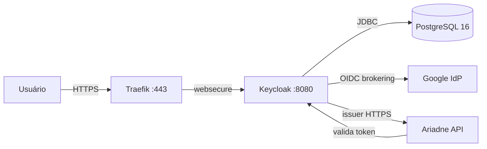

# Keycloak como broker OIDC: identidade sem acoplar ao provedor

Quando o Ariadne precisou de autenticação, a tentação era integrar diretamente com o Google. Um botão "Login com Google", um token JWT, e pronto.

Funciona. Mas cria um acoplamento que não queremos: o Ariadne passa a depender de um provedor específico, e trocar de provedor (ou adicionar um segundo) exige mudar código.

A decisão foi diferente: **um broker OIDC auto-hospedado**. O Keycloak fica entre o Ariadne e qualquer provedor de identidade. O Ariadne valida tokens contra o Keycloak. O Keycloak valida contra o Google (ou qualquer outro). Trocar de provedor é configuração, não código.

## Por que Keycloak e não Auth0/Okta/Clerk

Serviços gerenciados resolvem o problema em minutos. Mas este projeto é um laboratório de engenharia, não um produto. Os objetivos são:

- entender como um broker OIDC funciona por dentro;
- manter controle total sobre os dados de identidade;
- poder reconstruir tudo do git;
- não depender de um serviço externo para autenticação básica.

O Keycloak é a escolha óbvia para isso: open source, bem documentado, com suporte a OIDC/OAuth2/SAML, e com uma imagem Docker oficial que roda em Kubernetes sem surpresas (quase).

## A arquitetura



Componentes:

- **Keycloak 26.0.7** (imagem `quay.io/keycloak/keycloak`) em modo produção (`start`), com PostgreSQL como banco durável.
- **PostgreSQL 16** (`postgres:16-alpine`) com PVC `local-path` de 5Gi — estado persistente, não efêmero.
- **Ingress** `auth.guiosoft.info` via Traefik, pinado ao entrypoint `websecure`, com certificado mkcert (mesmo padrão do registry).
- **Secrets** cifrados com SOPS + age (credenciais de DB e admin).

O Keycloak é **LAN-only**: regra `auth.guiosoft.info -> http_status:404` no Cloudflare Tunnel antes do wildcard, e split-DNS no MikroTik. O mesmo padrão do registry e do Firecrawl.

## O deploy

O deploy segue o padrão do projeto: namespace → secrets → app, reconciliado pelo Flux.

```text
kubernetes/
├── namespaces/keycloak/       # namespace + kustomization
├── secrets/keycloak/          # SOPS-encrypted secrets
└── apps/keycloak/             # postgres.yaml, keycloak.yaml, ingress.yaml
clusters/guiosoft-info/
├── keycloak-namespace.yaml
├── keycloak-secrets.yaml
└── keycloak.yaml
```

O Keycloak roda com `start` (modo produção) e variáveis de ambiente:

```yaml
KC_DB: postgres
KC_DB_URL: jdbc:postgresql://keycloak-postgres:5432/keycloak
KC_HOSTNAME: https://auth.guiosoft.info
KC_HTTP_ENABLED: "true"
KC_PROXY_HEADERS: xforwarded
KC_HEALTH_ENABLED: "true"
```

O `KC_HOSTNAME` é a URL completa (com `https://`), não apenas o hostname. Isso é crítico para que o issuer no token seja HTTPS. O `KC_PROXY_HEADERS=xforwarded` diz ao Keycloak para confiar nos headers `X-Forwarded-*` do Traefik.

## As armadilhas

### O hostname que virou URL

Sintoma: o issuer no token era `http://auth.guiosoft.info/realms/master` em vez de `https://`. O Ariadne rejeitava o token por mismatch de issuer.

Causa: `KC_HOSTNAME` configurado como `auth.guiosoft.info` (apenas o hostname). O Keycloak construía URLs com `http://` porque não sabia que estava atrás de um proxy TLS.

A correção: `KC_HOSTNAME=https://auth.guiosoft.info` (URL completa). Com isso, o issuer, o authorization endpoint, o token endpoint e o JWKS URI passam a usar HTTPS.

A lição: **em Keycloak 26, `KC_HOSTNAME` aceita URL completa.** Use-a quando estiver atrás de um proxy TLS.

### O proxy que o Keycloak ignorava

Sintoma: mesmo com `KC_HOSTNAME` correto, o `login-status-iframe.html` retornava 403 e o profile page não carregava.

Causa: `KC_PROXY=edge` (deprecated em v26) não estava processando os headers `X-Forwarded-Proto` do Traefik corretamente. O Keycloak achava que a requisição era HTTP, causando problemas de CSRF/CORS.

A correção: substituir `KC_PROXY=edge` por `KC_PROXY_HEADERS=xforwarded`. O warning `Hostname v1 options [proxy] are still in use` desapareceu.

A lição: **configurações deprecadas em v26 podem parecer funcionar mas causar problemas sutis.** Sempre use a forma atual.

### A porta 9000 que ninguém mencionou

Sintoma: o Pod ficava `0/1` (not ready) indefinidamente. O Keycloak iniciava normalmente (logs mostravam "started in 59s"), mas o readiness probe falhava.

Causa: o readiness probe estava configurado para a porta `http` (8080) com path `/health/ready`. Mas em Keycloak 26, o health endpoint está na **porta 9000** (management interface), não na 8080.

A correção: adicionar a porta `management` (9000) no container e apontar os probes para ela.

A lição: **Keycloak 26 separa a interface HTTP (8080) da management (9000).** Health, metrics e management endpoints estão na 9000. A documentação nem sempre deixa isso claro.

### As variáveis de ambiente deprecadas

Sintoma: warnings nos logs: `Environment variable 'KEYCLOAK_ADMIN' is deprecated, use 'KC_BOOTSTRAP_ADMIN_USERNAME' instead`.

Causa: Keycloak 26 deprecou `KEYCLOAK_ADMIN` / `KEYCLOAK_ADMIN_PASSWORD` em favor de `KC_BOOTSTRAP_ADMIN_USERNAME` / `KC_BOOTSTRAP_ADMIN_PASSWORD`.

A correção: renomear as env vars e as chaves no secret SOPS. O comportamento é o mesmo.

A lição: **variáveis deprecadas funcionam mas geram warnings.** Corrija na hora — os warnings podem virar erros em versões futuras.

### O wildcard de porta que o Keycloak rejeitava

Sintoma: redirect para o Google retornava `invalid_redirect_uri` mesmo com `http://localhost:*/callback` registrado.

Causa: Keycloak 26 valida wildcards de porta de forma mais estrita. O padrão `http://localhost:*/callback` não era aceito.

A correção: registrar `http://localhost:*` (sem o path `/callback`) como redirect URI. Isso aceita qualquer porta e qualquer path em localhost.

A lição: **em Keycloak 26, wildcards de porta funcionam melhor sem path restrito.** Use `http://localhost:*` para desenvolvimento.

## Google identity brokering

O Google é configurado como IdP no realm `guiosoft`:

```json
{
  "alias": "google",
  "providerId": "google",
  "enabled": true,
  "trustEmail": true,
  "config": {
    "clientId": "179626170761-...apps.googleusercontent.com",
    "clientSecret": "***",
    "defaultScope": "openid profile email"
  }
}
```

O client secret é armazenado no Keycloak DB (não commitado). Um backup SOPS (`keycloak-google-idp.sops.yaml`) é mantido fora do kustomization para recovery.

O redirect URI no Google Cloud Console: `https://auth.guiosoft.info/realms/guiosoft/broker/google/endpoint`

O fluxo testado:
1. Usuário clica "Google" (ou `kc_idp_hint=google`)
2. Keycloak redireciona para o Google (consentimento)
3. Google redireciona de volta para o broker endpoint
4. Keycloak cria/vincula a conta (first broker login)
5. Keycloak redireciona para a aplicação com authorization code

## Backup e recovery

### Backup

```bash
 # Dump do PostgreSQL
kubectl -n keycloak exec deploy/keycloak-postgres -- \
  pg_dump -U keycloak -d keycloak --clean --if-exists > keycloak-backup.sql

 # Export do realm (configuração sem segredos)
curl -sk -H "Authorization: Bearer $TOKEN" \
  https://auth.guiosoft.info/admin/realms/guiosoft -o gui osft-realm.json
```

### Recovery testado

O recovery foi testado de ponta a ponta:
1. Backup: pg_dump (324K, 87 tabelas)
2. Simulação de perda: `DROP DATABASE keycloak` + `CREATE DATABASE keycloak`
3. Restore: `psql -U keycloak -d keycloak < backup.sql`
4. Verificação: Keycloak reiniciou, issuer acessível, admin login OK, clientes e Google IdP preservados

**Tempo de recovery**: ~20 segundos (startup do Keycloak após restore).

A lição: **um backup de banco de dados não é um recovery até ser testado.** O pg_dump parecia suficiente, mas a única certeza veio do drop + restore real.

## Integração com o Ariadne

> **Nota:** Ariadne é uma plataforma de contexto de engenharia para humanos e agentes de IA — mantém um grafo de conhecimento rastreável sobre projetos, código, dependências, decisões e histórico de mudanças, para que contexto não precise ser redescoberto a cada sessão. Documentação detalhada em breve no blog, na seção Homelab.

O Ariadne usa o Keycloak como provedor OIDC. A configuração no Ariadne (ADR 0008):

```yaml
identity:
  oidc:
    issuer: "https://auth.guiosoft.info/realms/guiosoft"
    audience: "ariadne-api"
    bootstrap:
      subject: "ab332186-528e-43ef-8b0a-3ba3bb9037c3"
      user_id: "guionardo"
      display_name: "Guionardo Furlan"
      email: "guionardo@gmail.com"
```

### O que o Ariadne lê do token

Apenas três claims (conforme `oidc_verifier.go`):
- `iss` — validado contra o issuer configurado
- `sub` — identificador estável do usuário
- `aud` — validado contra `identity.oidc.audience`

O tenant é configurado por instância (não vem do token). Roles e groups não são usados para autorização (Ariadne é autoritativo). O mapper `Subject (sub)` deve estar presente no client scope do cliente; se o scope padrão `basic` não estiver associado, adicione-o explicitamente.

### O bootstrap

Na primeira inicialização, o Ariadne provisiona o usuário com o par `(issuer, subject)` e cria:
- Usuário no `identities.json`
- External identity (issuer + subject)
- Tenant membership
- Project grants para todos os projetos do manifest

O `sub` usado é o UUID do usuário no Keycloak (`ab332186-528e-43ef-8b0a-3ba3bb9037c3`), não o sub do Google. O Ariadne resolve identidades pela chave `(issuer, subject)` do Keycloak, não do provedor upstream.

### ADR 0008: identidade externa, autorização interna

A decisão arquitetural (ADR 0008) separa:
- **Autenticação**: delegada ao Keycloak (que pode usar Google, Microsoft, etc.)
- **Autorização**: controlada pelo Ariadne (tenant membership, team membership, project permissions)
- **Credenciais de integração**: separadas das credenciais de login (GitHub App, Jira OAuth, etc.)

Isso significa que um desenvolvedor pode autenticar via Google enquanto trabalha num projeto cujos repositórios estão no GitHub. O provedor de autenticação não precisa coincidir com o provedor de código.

## O que ainda não provei

- **Rotação de chaves do Keycloak** (JWT signing keys) — não testei, apenas a rotação da senha do admin
- **Logout end-to-end** — o endpoint responde 200, mas não testei o fluxo completo (redirect pós-logout)
- **Alta disponibilidade** — não é objetivo (single-node, SQLite datastore do K3s)
- **Exposição pública** — o certificado mkcert é para LAN; exposição pública exige cert-manager/Let's Encrypt

## O que mudou na minha definição de identidade

Antes do Keycloak, "autenticação" significava "um botão de login com um provedor". Depois, significou "um broker que desacopla a identidade da autorização".

A lição mais importante: **o issuer no token deve ser exatamente o que o Ariadne espera**. Uma barra final, um `http://` em vez de `https://`, e o token é rejeitado. A normalização do issuer é o ponto de falha mais silencioso de toda a integração.

---

Projeto: `guionardo/guiosoft-k3s-lab`. Issue: `guionardo/guiosoft-k3s-lab#6`. ADR: `guiosoft/ariadne/docs/adr/0008-external-identity-and-internal-authorization.md`.
