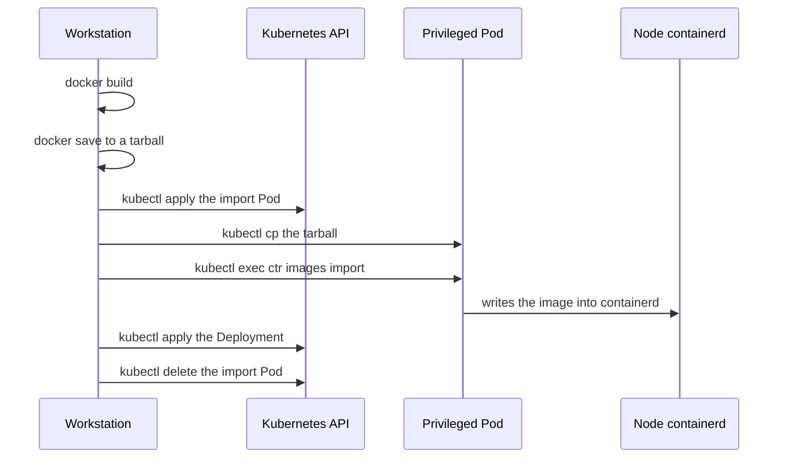
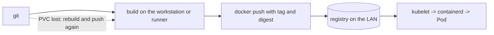

# From `docker save` to `docker push`: OCI images without node privilege

For months, publishing an image in my homelab was a six-step ritual.

Build. Save to a tarball. Start a temporary Pod with a `hostPath` mount on the containerd socket. Copy the tarball into the Pod. Run `ctr images import`. Only then apply the Deployment — and hope the cleanup `trap` had not failed.

It worked. And precisely because it worked, I took a long time to look at what it actually was.

## The ritual, step by step



Five hops to move bytes that were already in a public registry or in a local directory. None of them related to what I wanted to do, which was simply *declare that this image should run*.

## I still had that ritual in the repository

Before criticising the flow, a confession: it is still here.

`scripts/otel-go-demo.sh` runs `docker build`, `docker save` and `sudo k3s ctr images import`. Both Deployments of the demo application use:

```yaml
image: guiosoft/otel-go-demo:dev
imagePullPolicy: Never
```

That `Never` is the system's confession. A manifest that has to tell the kubelet "do not try to fetch this image" is admitting the image arrived from outside — that someone put it on the node by hand. The cluster runs it, but does not know where it came from, what its identity is, or when it may be discarded.

## The three real problems

The first is the most obvious and the most serious: **the containerd socket is equivalent to root on the node**. Any Pod that mounts it can import, replace or delete images. I had a permanent arbitrary-code-execution path whose only justification was moving a file.

The second is subtler: **the image was present, but not declared**. No digest, no pull policy, no relationship to the workload's lifecycle. The kubelet did not know how that image got there. And what is not declared is not reproducible: reinstalling the node, changing machines or rebuilding the cluster produces a different state from today's.

The third is the one that bothered me most afterwards: **the flow depended on node access**. It could not be done from another machine on the LAN, nor from a CI script, nor from someone else's laptop. The critical deployment path went through a `sudo` that existed only on that one machine.

## What changes when the image is declared

With an OCI registry inside the LAN, the push becomes:

```bash
TAG="registry.guiosoft.info/app/api:k3s-$(date +%Y%m%d%H%M%S)"
docker build -t "$TAG" .
docker push "$TAG"
```

The image now has an address and a digest. Transport is done by the cluster itself — the kubelet talks to containerd, which talks to the registry. The only credential involved is an `imagePullSecrets` entry in the workload's namespace. No privileged Pod, no `hostPath`, no node access.

```yaml
spec:
  imagePullSecrets:
    - name: registry-pull
  containers:
    - name: api
      image: registry.guiosoft.info/app/api:k3s-20261106094625
```

The gain is not aesthetic. It is that **deployment stopped needing root**. And a step that does not need root can be run by anything: a person, a script, a runner.

## The objection I had: what if I lose the registry?

That was the question that blocked me the longest.

The registry lives on a 20Gi PVC. If that volume is lost, corrupted or recreated, the images are gone. The answer I had to accept is:

**the registry is a cache, not a source of truth.**



Every image in it can be rebuilt from git. No cluster state depends on its contents. Pods already running are unaffected by a lost PVC, because their image is already in the node's containerd cache.

That has concrete consequences, and they are what make the property real instead of a nice sentence:

- the registry PVC directory is **excluded from the PV snapshot**, with the exclusion computed at runtime from the live `claimRef` — so it survives reprovisioning, when the `pvc-<uuid>` directory changes name;
- the DR preflight **fails** if any PV from the `registry` namespace appears in the recovery set;
- if the PVC is recreated, Flux reconciles an empty registry and the cycle restarts on the next push.

The distinction I started using: *backup* answers "what can I not rebuild"; *registry* answers "what do I want to move fast". Mixing the two is how a cache becomes a dependency.

## Three traps that cost real time

### The 404 that looked like an authentication problem

Symptom: `docker push` failed with `404 page not found`. `docker login` too. But the same URL, forced to the node's internal IP, answered `401` — the registry was there.

Cause: the workstation resolved the hostname through public DNS, landed on the Cloudflare Tunnel, and the Tunnel handed the request to Traefik on port 80. The registry Ingress was pinned to the `websecure` entrypoint — a pin I had added precisely as a second layer of public blocking. Result: there was no route on port 80, and Traefik answered `404` before anything credential-related.

What made it confusing was that `401`: it reads as "your password is wrong", so I went debugging password, htpasswd, Secret — while the problem was routing.

The fix was not in the registry: it was a split-DNS entry on the LAN router, pointing the hostname at the node's internal IP.

The lesson I keep: **in a registry, `404` almost never means "wrong path"**. It means "you never reached the registry".

### The `configs` that containerd ignored silently

The node needed to trust Traefik's self-signed certificate. I wrote `registries.yaml` with the TLS block nested under `config:`, which is the shape I had inferred from examples.

k3s started without error. The file was in place, with the right permissions. And Pod pulls kept failing with a TLS error.

containerd simply ignored the nested key. No warning, no log, no exit code. The correct structure uses `configs` at the top level:

```yaml
configs:
  "registry.guiosoft.info":
    tls:
      insecure_skip_verify: true
```

The lesson: **configuration that fails silently is worse than configuration that fails loudly**. And the only check that counts is behavioural — a real pull from inside a Pod, not "the service started" and not "the file exists".

### The certificate Docker did not trust

Symptom: `docker push` failed with a TLS error (`x509: certificate signed by unknown authority`), even though the hostname resolved correctly to the internal IP. `docker login` failed too.

Cause: Traefik uses its default self-signed certificate. The node's containerd trusts it via `insecure_skip_verify` in `registries.yaml`, but the Docker daemon is a separate process with its own TLS configuration. The node's Docker daemon had no `/etc/docker/daemon.json` — so no `insecure-registries` entry.

What made it confusing was that the node could reach the registry (curl worked), so it looked like an authentication or routing problem. But it was trust: the Docker daemon did not have the certificate in its trust chain.

The fix: create `/etc/docker/daemon.json` with `{ "insecure-registries": ["registry.guiosoft.info"] }` and restart Docker. This is separate from the containerd configuration (which uses `registries.yaml`).

The lesson: **containerd and Docker are different runtimes with independent TLS configurations.** Trusting the certificate in one does not imply trusting it in the other. And when push fails with TLS, the temptation is to give up and go back to `ctr images import` — which is exactly what I did before discovering that one line was missing from the daemon.

## Build and publish as part of CI

Here is why I do not consider the registry a luxury.

While publishing required `sudo` on the node and `kubectl cp`, it was **impossible in CI** — not hard, impossible. A runner does not have the machine's key, should not have it, and cannot depend on it. Removing the node from the path was not a side effect: it is what turned build and publish into a contract any runner can fulfil.

The contract is two lines and takes everything from the environment:

```bash
docker build -t "$TAG" .
docker push "$TAG"      # returns the sha256:... digest
```

No `kubectl`, no `sudo`, no host access. Whoever runs it needs exactly two things: a Docker daemon and **network route to the registry**.

That second condition is the honest limit of the current design. The registry is LAN-only; a cloud-hosted runner cannot reach `192.168.88.9`. So today "CI" means a runner inside the LAN — or the pipeline running wherever the network reaches. Public exposure is possible and documented as a path, but it requires a valid certificate, removing the blocking rule and, before anything else, resolving the read/write separation. It is not a flag.

Two decisions I had to make at this point:

**Tag or digest.** The timestamped tag is convenient for humans and for a `set image`, but a tag can be moved. A digest cannot. If the pipeline wants reproducibility, it records the digest the push returned. Except retention keeps the 10 most recently pushed tags per repository — so old digests *will* disappear. That is acceptable precisely because everything is rebuildable; it is the price of the cache, paid consciously.

**Who authenticates as what.** The builder uses `pusher`. The cluster uses `puller`, through a Secret created idempotently from an environment variable, never committed. And here is the debt I will not hide: Zot v2.1.22 authenticates, but **does not enforce read/write separation** — today `puller` can push too. While the registry is LAN-only, that is a convention. The day it becomes public, it becomes an incident.

## Tutorial: from zero to the first push

For anyone who wants to reproduce it, the minimal sequence:

1. **Certificate**: add `registry.guiosoft.info` to `insecure-registries` in the Docker daemon and restart (the certificate is Traefik's default self-signed one).
2. **Hostname**: split-DNS on the LAN, or `192.168.88.9 registry.guiosoft.info` in `/etc/hosts`.
3. **Password**: `bash scripts/registry-credentials.sh password pusher` — decrypts SOPS on the host over SSH; the age key never leaves the node.
4. **Login**: `docker login registry.guiosoft.info -u pusher` (or `make registry-login`).
5. **Push**: `TAG=registry.guiosoft.info/<repo>/<app>:k3s-$(date +%Y%m%d%H%M%S); docker build -t $TAG .; docker push $TAG`.
6. **Consumption**: create the `docker-registry` secret from the `puller` password and add `imagePullSecrets` + `imagePullPolicy: Always` to the Deployment.
7. **Verification**: `make registry-validate` (7 assertions) or the web UI at `https://registry.guiosoft.info/`.

Retention was exercised with a probe of 12 distinct tags: after the zot restart (GC on startup), 10 remained (`v3..v12`); `v1` and `v2` were evicted (manifests → 404). Confirms GC runs on startup and that `delay: 1h` does not block tag eviction.

## What I have not proven yet

- retention (10 tags per repository, GC every 24h) has never been exercised with real volume; I know what the configuration says, not what the GC did;
- the demo application still uses `imagePullPolicy: Never` and the import ritual — migrating it was out of scope, and pretending otherwise would be a lie;
- `puller` can push;
- the public blocking rule is declared in Terraform but not applied. What prevents external access today is the entrypoint pin, which is one line of configuration — not a policy. "It answers 404 today" is not the same as "it is blocked".

## What I would tell someone building their first homelab

Do not install a registry on day one. The ritual is acceptable for the first image, and probably for the second.

Install it when you notice one of these signals: you published the same image by hand twice; a second machine needs to build; or you want a CI to exist. At that point the ritual stops being a shortcut and becomes a ceiling.

And when you do install it: pick a hostname with no port, get the LAN DNS right **before** debugging authentication, and accept from the start that the registry is a cache. Write that down somewhere you will read during an incident, because during an incident the temptation to treat it as a source of truth is enormous.

The registry did not give me a better place to store images. It gave me a deployment path that does not need root — and, with it, the possibility of a pipeline existing.

---

Project: `guionardo/guiosoft-k3s-lab`.
