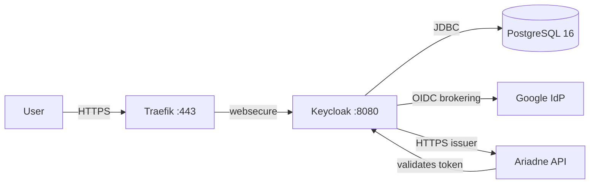

# Keycloak as an OIDC broker: identity without coupling to the provider

When Ariadne needed authentication, the temptation was to integrate directly with Google. A "Login with Google" button, a JWT token, and done.

It works. But it creates a coupling we do not want: Ariadne becomes dependent on a specific provider, and switching providers (or adding a second one) means changing code.

The decision was different: **a self-hosted OIDC broker**. Keycloak sits between Ariadne and any identity provider. Ariadne validates tokens against Keycloak. Keycloak validates against Google (or any other). Switching providers is configuration, not code.

## Why Keycloak and not Auth0/Okta/Clerk

Managed services solve the problem in minutes. But this project is an engineering lab, not a product. The goals are:

- understand how an OIDC broker works inside;
- keep full control over identity data;
- be able to rebuild everything from git;
- not depend on an external service for basic authentication.

Keycloak is the obvious choice: open source, well documented, with OIDC/OAuth2/SAML support, and an official Docker image that runs in Kubernetes without surprises (almost).

## The architecture



Components:

- **Keycloak 26.0.7** (image `quay.io/keycloak/keycloak`) in production mode (`start`), with PostgreSQL as the durable database.
- **PostgreSQL 16** (`postgres:16-alpine`) with a 5Gi `local-path` PVC — persistent state, not ephemeral.
- **Ingress** `auth.guiosoft.info` via Traefik, pinned to the `websecure` entrypoint, with an mkcert certificate (same pattern as the registry).
- **Secrets** encrypted with SOPS + age.

Keycloak is **LAN-only**: `auth.guiosoft.info -> http_status:404` rule in the Cloudflare Tunnel before the wildcard, plus split-DNS on the MikroTik. Same pattern as the registry and Firecrawl.

## The deployment

The deploy follows the project pattern: namespace → secrets → app, reconciled by Flux.

```text
kubernetes/
├── namespaces/keycloak/       # namespace + kustomization
├── secrets/keycloak/          # SOPS-encrypted secrets
└── apps/keycloak/             # postgres.yaml, keycloak.yaml, ingress.yaml
clusters/guiosoft-info/
├── keycloak-namespace.yaml
├── keycloak-secrets.yaml
└── keycloak.yaml
```

Keycloak runs with `start` (production mode) and environment variables:

```yaml
KC_DB: postgres
KC_DB_URL: jdbc:postgresql://keycloak-postgres:5432/keycloak
KC_HOSTNAME: https://auth.guiosoft.info
KC_HTTP_ENABLED: "true"
KC_PROXY_HEADERS: xforwarded
KC_HEALTH_ENABLED: "true"
```

`KC_HOSTNAME` is the full URL (with `https://`), not just the hostname. This is critical for the issuer in the token to be HTTPS. `KC_PROXY_HEADERS=xforwarded` tells Keycloak to trust the `X-Forwarded-*` headers from Traefik.

## The traps

### The hostname that became a URL

Symptom: the issuer in the token was `http://auth.guiosoft.info/realms/master` instead of `https://`. Ariadne rejected the token for issuer mismatch.

Cause: `KC_HOSTNAME` configured as `auth.guiosoft.info` (hostname only). Keycloak built URLs with `http://` because it did not know it was behind a TLS proxy.

The fix: `KC_HOSTNAME=https://auth.guiosoft.info` (full URL). With that, the issuer, authorization endpoint, token endpoint and JWKS URI all use HTTPS.

The lesson: **in Keycloak 26, `KC_HOSTNAME` accepts a full URL.** Use it when behind a TLS proxy.

### The proxy Keycloak ignored

Symptom: even with the correct `KC_HOSTNAME`, `login-status-iframe.html` returned 403 and the profile page would not load.

Cause: `KC_PROXY=edge` (deprecated in v26) was not processing the `X-Forwarded-Proto` headers from Traefik correctly. Keycloak thought the request was HTTP, causing CSRF/CORS issues.

The fix: replace `KC_PROXY=edge` with `KC_PROXY_HEADERS=xforwarded`. The warning `Hostname v1 options [proxy] are still in use` disappeared.

The lesson: **deprecated v26 settings may appear to work but cause subtle problems.** Always use the current form.

### Port 9000, which nobody mentioned

Symptom: the Pod stayed `0/1` (not ready) indefinitely. Keycloak started normally (logs showed "started in 59s"), but the readiness probe failed.

Cause: the readiness probe was configured for port `http` (8080) with path `/health/ready`. But in Keycloak 26, the health endpoint is on **port 9000** (management interface), not 8080.

The fix: add the `management` port (9000) to the container and point the probes at it.

The lesson: **Keycloak 26 separates the HTTP interface (8080) from management (9000).** Health, metrics and management endpoints are on 9000. The documentation does not always make this clear.

### The deprecated environment variables

Symptom: warnings in the logs: `Environment variable 'KEYCLOAK_ADMIN' is deprecated, use 'KC_BOOTSTRAP_ADMIN_USERNAME' instead`.

Cause: Keycloak 26 deprecated `KEYCLOAK_ADMIN` / `KEYCLOAK_ADMIN_PASSWORD` in favour of `KC_BOOTSTRAP_ADMIN_USERNAME` / `KC_BOOTSTRAP_ADMIN_PASSWORD`.

The fix: rename the env vars and the secret keys. Behaviour is the same.

The lesson: **deprecated variables work but produce warnings.** Fix them immediately — warnings may become errors in future versions.

### The port wildcard Keycloak rejected

Symptom: redirect to Google returned `invalid_redirect_uri` even with `http://localhost:*/callback` registered.

Cause: Keycloak 26 validates port wildcards more strictly. The pattern `http://localhost:*/callback` was not accepted.

The fix: register `http://localhost:*` (without the `/callback` path) as the redirect URI. This accepts any port and any path on localhost.

The lesson: **in Keycloak 26, port wildcards work better without a restricted path.** Use `http://localhost:*` for development.

## Google identity brokering

Google is configured as an IdP in the `guiosoft` realm:

```json
{
  "alias": "google",
  "providerId": "google",
  "enabled": true,
  "trustEmail": true,
  "config": {
    "clientId": "179626170761-...apps.googleusercontent.com",
    "clientSecret": "***",
    "defaultScope": "openid profile email"
  }
}
```

The client secret is stored in the Keycloak DB (not committed). A SOPS backup (`keycloak-google-idp.sops.yaml`) is kept outside the kustomization for recovery.

The redirect URI in the Google Cloud Console: `https://auth.guiosoft.info/realms/guiosoft/broker/google/endpoint`

The tested flow:
1. User clicks "Google" (or `kc_idp_hint=google`)
2. Keycloak redirects to Google (consent)
3. Google redirects back to the broker endpoint
4. Keycloak creates/links the account (first broker login)
5. Keycloak redirects to the application with an authorization code

## Backup and recovery

### Backup

```bash
 # PostgreSQL dump
kubectl -n keycloak exec deploy/keycloak-postgres -- \
  pg_dump -U keycloak -d keycloak --clean --if-exists > keycloak-backup.sql

 # Realm export (configuration without secrets)
curl -sk -H "Authorization: Bearer $TOKEN" \
  https://auth.guiosoft.info/admin/realms/guiosoft -o gui osft-realm.json
```

### Recovery tested

Recovery was tested end to end:
1. Backup: pg_dump (324K, 87 tables)
2. Simulated loss: `DROP DATABASE keycloak` + `CREATE DATABASE keycloak`
3. Restore: `psql -U keycloak -d keycloak < backup.sql`
4. Verification: Keycloak restarted, issuer accessible, admin login OK, clients and Google IdP preserved

**Recovery time**: ~20 seconds (Keycloak startup after restore).

The lesson: **a database backup is not a recovery until it is tested.** The pg_dump looked sufficient, but certainty only came from the actual drop + restore.

## Integration with Ariadne

> **Note:** Ariadne is a project under development that will become a product. Detailed documentation will be published on the blog soon, in the Homelab section.

Ariadne uses Keycloak as its OIDC provider. The configuration in Ariadne (ADR 0008):

```yaml
identity:
  oidc:
    issuer: "https://auth.guiosoft.info/realms/guiosoft"
    audience: "ariadne-api"
    bootstrap:
      subject: "ab332186-528e-43ef-8b0a-3ba3bb9037c3"
      user_id: "guionardo"
      display_name: "Guionardo Furlan"
      email: "guionardo@gmail.com"
```

### What Ariadne reads from the token

Only three claims (per `oidc_verifier.go`):
- `iss` — validated against the configured issuer
- `sub` — stable user identifier
- `aud` — validated against `identity.oidc.audience`

The tenant is configured per instance (not from the token). Roles and groups are not used for authorization (Ariadne is authoritative). No custom mappers are needed in Keycloak.

### The bootstrap

On first startup, Ariadne provisions the user with the `(issuer, subject)` pair and creates:
- User in `identities.json`
- External identity (issuer + subject)
- Tenant membership
- Project grants for all projects in the manifest

The `sub` used is the Keycloak user's UUID (`ab332186-528e-43ef-8b0a-3ba3bb9037c3`), not the Google sub. Ariadne resolves identities by the Keycloak `(issuer, subject)` key, not the upstream provider.

### ADR 0008: external identity, internal authorization

The architectural decision (ADR 0008) separates:
- **Authentication**: delegated to Keycloak (which can use Google, Microsoft, etc.)
- **Authorization**: controlled by Ariadne (tenant membership, team membership, project permissions)
- **Integration credentials**: separate from login credentials (GitHub App, Jira OAuth, etc.)

This means a developer can authenticate via Google while working on a project whose repositories are on GitHub. The authentication provider does not need to match the code provider.

## What I have not proven yet

- **Keycloak key rotation** (JWT signing keys) — not tested, only admin password rotation
- **End-to-end logout** — the endpoint responds 200, but the full flow (redirect after logout) was not tested
- **High availability** — not a goal (single-node, K3s SQLite datastore)
- **Public exposure** — the mkcert certificate is for LAN; public exposure requires cert-manager/Let's Encrypt

## What changed in my definition of identity

Before Keycloak, "authentication" meant "a login button with a provider". After, it meant "a broker that decouples identity from authorization".

The most important lesson: **the issuer in the token must be exactly what Ariadne expects.** A trailing slash, an `http://` instead of `https://`, and the token is rejected. Issuer normalization is the most silent failure point in the entire integration.

---

Project: `guionardo/guiosoft-k3s-lab`. Issue: `guionardo/guiosoft-k3s-lab#6`. ADR: `guiosoft/ariadne/docs/adr/0008-external-identity-and-internal-authorization.md`.