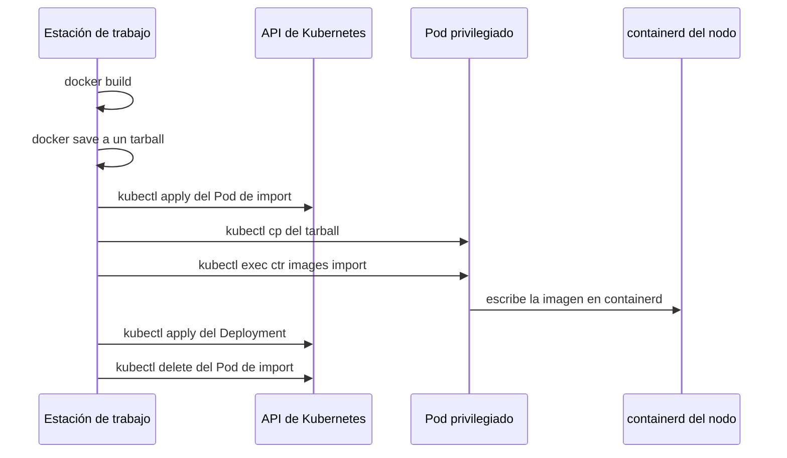
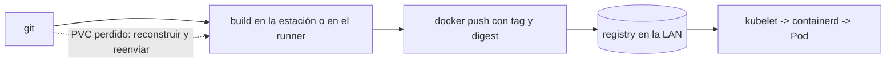

# De `docker save` a `docker push`: imágenes OCI sin privilegios en el nodo

Durante meses, publicar una imagen en mi homelab fue un ritual de seis pasos.

Construir. Guardar en un tarball. Levantar un Pod temporal con `hostPath` sobre el socket de containerd. Copiar el tarball dentro del Pod. Ejecutar `ctr images import`. Solo entonces aplicar el Deployment — y esperar que el `trap` de limpieza no hubiera fallado.

Funcionaba. Y fue justamente porque funcionaba que tardé tanto en mirar qué era realmente.

## El ritual, paso a paso



Cinco saltos para mover bytes que ya estaban en un registry público o en un directorio local. Ninguno relacionado con lo que yo quería hacer, que era simplemente *declarar que esa imagen debía ejecutarse*.

## Todavía tenía ese ritual en el repositorio

Antes de criticar el flujo, corresponde la confesión: sigue aquí.

`scripts/otel-go-demo.sh` hace `docker build`, `docker save` y `sudo k3s ctr images import`. Los dos Deployments de la aplicación de demostración usan:

```yaml
image: guiosoft/otel-go-demo:dev
imagePullPolicy: Never
```

Ese `Never` es la confesión del sistema. Un manifiesto que necesita decirle al kubelet "no intentes buscar esta imagen" está admitiendo que la imagen llegó por fuera — que alguien la puso en el nodo a mano. El clúster la ejecuta, pero no sabe de dónde vino, ni cuál es su identidad, ni cuándo puede descartarse.

## Los tres problemas reales

El primero es el más obvio y el más grave: **el socket de containerd equivale a root en el nodo**. Cualquier Pod que lo monte puede importar, reemplazar o borrar imágenes. Yo tenía un camino permanente de ejecución de código arbitrario cuya única justificación era transportar un archivo.

El segundo es más sutil: **la imagen quedaba presente, pero no declarada**. Sin digest, sin política de pull, sin relación con el ciclo de vida del workload. El kubelet no sabía cómo había llegado esa imagen. Y lo que no está declarado no es reproducible: reinstalar el nodo, cambiar de máquina o reconstruir el clúster produce un estado distinto del actual.

El tercero es el que más me molestó después: **el flujo dependía de acceso al nodo**. No se podía publicar desde otra máquina de la LAN, ni desde un script de CI, ni desde el portátil de otra persona. El camino crítico de despliegue pasaba por un `sudo` que solo existía en esa máquina.

## Qué cambia cuando la imagen se declara

Con un registry OCI dentro de la LAN, el push pasa a ser:

```bash
TAG="registry.guiosoft.info/app/api:k3s-$(date +%Y%m%d%H%M%S)"
docker build -t "$TAG" .
docker push "$TAG"
```

La imagen pasa a tener dirección y digest. El transporte lo hace el propio clúster — el kubelet habla con containerd, que habla con el registry. La única credencial involucrada es un `imagePullSecrets` en el namespace del workload. Ningún Pod privilegiado, ningún `hostPath`, ningún acceso al nodo.

```yaml
spec:
  imagePullSecrets:
    - name: registry-pull
  containers:
    - name: api
      image: registry.guiosoft.info/app/api:k3s-20261106094625
```

La ganancia no es estética. Es que **el despliegue dejó de necesitar root**. Y un paso que no necesita root puede ejecutarlo cualquier cosa: una persona, un script, un runner.

## La objeción que yo tenía: ¿y si pierdo el registry?

Esa fue la pregunta que me bloqueó durante más tiempo.

El registry vive en un PVC de 20Gi. Si ese volumen se pierde, se corrompe o se recrea, las imágenes se van. La respuesta que tuve que aceptar es:

**el registry es caché, no fuente de verdad.**



Toda imagen que contiene es reconstruible desde git. Ningún estado del clúster depende de su contenido. Los Pods ya en ejecución no se ven afectados por la pérdida del PVC, porque su imagen ya está en la caché de containerd del nodo.

Eso tiene consecuencias concretas, y son ellas las que hacen la propiedad real en lugar de una frase bonita:

- el directorio del PVC del registry queda **excluido del snapshot de PVs**, con la exclusión calculada en runtime a partir del `claimRef` vivo — por eso sobrevive a un reprovisionamiento, cuando el directorio `pvc-<uuid>` cambia de nombre;
- el preflight de DR **falla** si aparece cualquier PV del namespace `registry` en el recovery set;
- si el PVC se recrea, Flux reconcilia el registry vacío y el ciclo vuelve a empezar en el próximo push.

La distinción que empecé a usar: *backup* responde "qué no puedo reconstruir"; *registry* responde "qué quiero mover rápido". Mezclar las dos cosas es cómo una caché se convierte en dependencia.

## Tres trampas que costaron tiempo de verdad

### El 404 que parecía un problema de autenticación

Síntoma: `docker push` fallaba con `404 page not found`. `docker login` también. Pero la misma URL, forzada a la IP interna del nodo, respondía `401` — el registry estaba ahí.

Causa: la estación resolvía el hostname por el DNS público, caía en el Cloudflare Tunnel, y el Tunnel entregaba la petición a Traefik en el puerto 80. El Ingress del registry estaba fijado al entrypoint `websecure` — un pin que yo había puesto justamente como segunda capa de bloqueo público. Resultado: en el puerto 80 no existía ruta, y Traefik respondía `404` antes de cualquier cosa relacionada con credenciales.

Lo que hizo confuso el diagnóstico fue ese `401`: suena a "tu contraseña está mal", así que fui a depurar contraseña, htpasswd, Secret — mientras el problema era de ruteo.

La corrección no fue en el registry: fue una entrada de split-DNS en el router de la LAN, apuntando el hostname a la IP interna del nodo.

La lección que me llevo: **en un registry, `404` casi nunca significa "camino equivocado"**. Significa "no llegaste al registry".

### El `configs` que containerd ignoró en silencio

El nodo necesitaba confiar en el certificado autofirmado de Traefik. Escribí el `registries.yaml` con el bloque TLS anidado dentro de `config:`, que es la forma que había inferido de ejemplos.

k3s arrancó sin error. El archivo estaba en su lugar, con los permisos correctos. Y el pull desde un Pod seguía fallando con error de TLS.

containerd simplemente ignoró la clave anidada. Sin aviso, sin log, sin exit code. La estructura correcta usa `configs` en el nivel superior:

```yaml
configs:
  "registry.guiosoft.info":
    tls:
      insecure_skip_verify: true
```

La lección: **la configuración que falla en silencio es peor que la que falla alto**. Y la única verificación que vale es de comportamiento — un pull real desde dentro de un Pod, no "el servicio arrancó" ni "el archivo existe".

### El certificado en el que Docker no confiaba

Síntoma: `docker push` fallaba con error de TLS (`x509: certificate signed by unknown authority`), aunque el hostname resolvía correctamente a la IP interna. `docker login` también fallaba.

Causa: Traefik usa el certificado autofirmado por defecto. El containerd del nodo confía en él vía `insecure_skip_verify` en `registries.yaml`, pero el daemon de Docker es un proceso separado con su propia configuración de TLS. El daemon de Docker del nodo no tenía `/etc/docker/daemon.json` — por tanto, ninguna entrada en `insecure-registries`.

Lo que confundió fue que el nodo alcanzaba el registry (curl funcionaba), así que parecía un problema de autenticación o de ruteo. Pero era de confianza: el daemon de Docker no tenía el certificado en su cadena de confianza.

La corrección: crear `/etc/docker/daemon.json` con `{ "insecure-registries": ["registry.guiosoft.info"] }` y reiniciar Docker. Esto es independiente de la configuración de containerd (que usa `registries.yaml`).

La lección: **containerd y Docker son runtimes distintos con configuraciones de TLS independientes.** Confiar en el certificado en uno no implica confiar en el otro. Y cuando el push falla con TLS, la tentación es rendirse y volver a `ctr images import` — que fue exactamente lo que hice antes de descubrir que faltaba una línea en el daemon.

## Build y publish como parte del CI

Aquí está el motivo por el que no considero el registry un lujo.

Mientras el publish exigía `sudo` en el nodo y `kubectl cp`, era **imposible en CI** — no difícil, imposible. Un runner no tiene la llave de la máquina, no debería tenerla, y no puede depender de ella. Sacar el nodo del camino no fue un efecto colateral: fue lo que convirtió build y publish en un contrato que cualquier runner puede cumplir.

El contrato tiene dos líneas y toma todo del entorno:

```bash
docker build -t "$TAG" .
docker push "$TAG"      # devuelve el digest sha256:...
```

Sin `kubectl`, sin `sudo`, sin acceso al host. Quien lo ejecuta necesita exactamente dos cosas: un daemon Docker y **ruta de red hasta el registry**.

Esa segunda condición es el límite honesto del diseño actual. El registry es LAN-only; un runner alojado en la nube no alcanza `192.168.88.9`. Así que hoy "CI" significa un runner dentro de la LAN — o el pipeline corriendo donde la red alcanza. La exposición pública es posible y está documentada como camino, pero exige certificado válido, remover la regla de bloqueo y, antes que nada, resolver la separación lectura/escritura. No es una flag.

Dos decisiones que tuve que tomar en ese punto:

**Tag o digest.** El tag con timestamp es cómodo para humanos y para un `set image`, pero un tag puede moverse. Un digest no. Si el pipeline quiere reproducibilidad, registra el digest que devolvió el push. Solo que la retención mantiene los 10 tags más recientes por repositorio — así que los digests viejos *van* a desaparecer. Eso es aceptable precisamente porque todo es reconstruible; es el precio de la caché, pagado de forma consciente.

**Quién autentica qué.** El builder usa `pusher`. El clúster usa `puller`, mediante un Secret creado de forma idempotente a partir de una variable de entorno, nunca commiteado. Y aquí entra la deuda que no voy a esconder: Zot v2.1.22 autentica, pero **no impone separación lectura/escritura** — hoy `puller` también puede hacer push. Mientras el registry es LAN-only, eso es convención. El día que sea público, se vuelve incidente.

## Tutorial: de cero al primer push

Para quien quiera reproducirlo, la secuencia mínima:

1. **Certificado**: añade `registry.guiosoft.info` a `insecure-registries` en el daemon de Docker y reinicia (el certificado es el autofirmado por defecto de Traefik).
2. **Hostname**: split-DNS en la LAN, o `192.168.88.9 registry.guiosoft.info` en `/etc/hosts`.
3. **Contraseña**: `bash scripts/registry-credentials.sh password pusher` — descifra SOPS en el host por SSH; la clave age nunca sale del nodo.
4. **Login**: `docker login registry.guiosoft.info -u pusher` (o `make registry-login`).
5. **Push**: `TAG=registry.guiosoft.info/<repo>/<app>:k3s-$(date +%Y%m%d%H%M%S); docker build -t $TAG .; docker push $TAG`.
6. **Consumo**: crea el secret `docker-registry` a partir de la contraseña de `puller` y añade `imagePullSecrets` + `imagePullPolicy: Always` en el Deployment.
7. **Verificación**: `make registry-validate` (7 aserciones) o la interfaz web en `https://registry.guiosoft.info/`.

La retención se ejercitó con una sonda de 12 tags distintos: tras el reinicio de zot (GC en el arranque), quedaron 10 (`v3..v12`); `v1` y `v2` fueron evictados (manifests → 404). Confirma que el GC corre en el arranque y que `delay: 1h` no bloquea la evicción de tags.

## Lo que todavía no probé

- la retención (10 tags por repositorio, GC cada 24h) nunca se ejercitó con volumen real; sé lo que dice la configuración, no lo que hizo el GC;
- la aplicación de demostración sigue con `imagePullPolicy: Never` y el ritual de import — migrarla estaba fuera de alcance, y fingir lo contrario sería mentira;
- `puller` puede hacer push;
- la regla de bloqueo público está declarada en Terraform, pero no aplicada. Hoy lo que impide el acceso externo es el pin al entrypoint, que es una línea de configuración — no una política. "Responde 404 hoy" no es lo mismo que "está bloqueado".

## Qué le diría a quien está armando su primer homelab

No instales un registry el primer día. El ritual es aceptable para la primera imagen, y probablemente para la segunda.

Instálalo cuando notes una de estas señales: publicaste la misma imagen a mano dos veces; una segunda máquina necesita construir; o quieres que un CI exista. En ese momento el ritual deja de ser un atajo y pasa a ser un techo.

Y cuando lo instales: elige un hostname sin puerto, acierta el DNS de la LAN **antes** de depurar autenticación, y acepta desde el principio que el registry es caché. Escríbelo donde vayas a leerlo durante un incidente, porque en el momento del incidente la tentación de tratarlo como fuente de verdad es enorme.

El registry no me dio un lugar mejor para guardar imágenes. Me dio un camino de despliegue que no necesita root — y, con él, la posibilidad de que un pipeline exista.

---

Proyecto: `guionardo/guiosoft-k3s-lab`.
