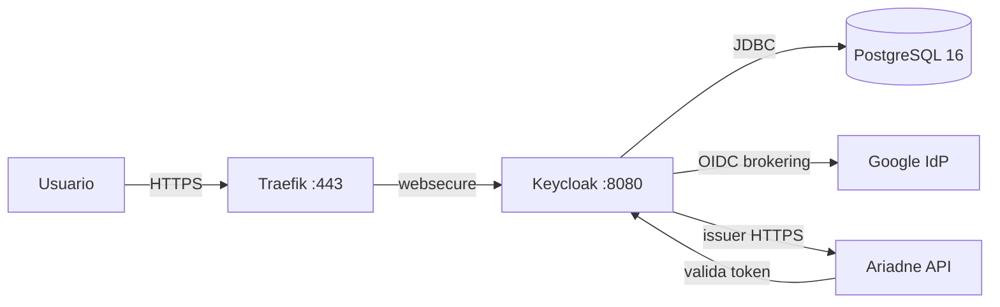

# Keycloak como broker OIDC: identidad sin acoplarse al proveedor

Cuando Ariadne necesitó autenticación, la tentación era integrar directamente con Google. Un botón "Login con Google", un token JWT, y listo.

Funciona. Pero crea un acoplamiento que no queremos: Ariadne pasa a depender de un proveedor específico, y cambiar de proveedor (o añadir un segundo) exige cambiar código.

La decisión fue diferente: **un broker OIDC autoalojado**. Keycloak queda entre Ariadne y cualquier proveedor de identidad. Ariadne valida tokens contra Keycloak. Keycloak valida contra Google (o cualquier otro). Cambiar de proveedor es configuración, no código.

## Por qué Keycloak y no Auth0/Okta/Clerk

Los servicios gestionados resuelven el problema en minutos. Pero este proyecto es un laboratorio de ingeniería, no un producto. Los objetivos son:

- entender cómo funciona un broker OIDC por dentro;
- mantener control total sobre los datos de identidad;
- poder reconstruir todo desde git;
- no depender de un servicio externo para autenticación básica.

Keycloak es la elección obvia: open source, bien documentado, con soporte a OIDC/OAuth2/SAML, y con una imagen Docker oficial que corre en Kubernetes sin sorpresas (casi).

## La arquitectura



Componentes:

- **Keycloak 26.0.7** (imagen `quay.io/keycloak/keycloak`) en modo producción (`start`), con PostgreSQL como base de datos duradera.
- **PostgreSQL 16** (`postgres:16-alpine`) con PVC `local-path` de 5Gi — estado persistente, no efímero.
- **Ingress** `auth.guiosoft.info` vía Traefik, fijado al entrypoint `websecure`, con certificado mkcert (mismo patrón que el registry).
- **Secrets** cifrados con SOPS + age.

Keycloak es **LAN-only**: regla `auth.guiosoft.info -> http_status:404` en el Cloudflare Tunnel antes del wildcard, más split-DNS en el MikroTik. El mismo patrón que el registry y Firecrawl.

## El despliegue

El despliegue sigue el patrón del proyecto: namespace → secrets → app, reconciliado por Flux.

```text
kubernetes/
├── namespaces/keycloak/       # namespace + kustomization
├── secrets/keycloak/          # secrets cifrados con SOPS
└── apps/keycloak/             # postgres.yaml, keycloak.yaml, ingress.yaml
clusters/guiosoft-info/
├── keycloak-namespace.yaml
├── keycloak-secrets.yaml
└── keycloak.yaml
```

Keycloak corre con `start` (modo producción) y variables de entorno:

```yaml
KC_DB: postgres
KC_DB_URL: jdbc:postgresql://keycloak-postgres:5432/keycloak
KC_HOSTNAME: https://auth.guiosoft.info
KC_HTTP_ENABLED: "true"
KC_PROXY_HEADERS: xforwarded
KC_HEALTH_ENABLED: "true"
```

`KC_HOSTNAME` es la URL completa (con `https://`), no solo el hostname. Esto es crítico para que el issuer en el token sea HTTPS. `KC_PROXY_HEADERS=xforwarded` le dice a Keycloak que confíe en los headers `X-Forwarded-*` de Traefik.

## Las trampas

### El hostname que se convirtió en URL

Síntoma: el issuer en el token era `http://auth.guiosoft.info/realms/master` en vez de `https://`. Ariadne rechazaba el token por mismatch de issuer.

Causa: `KC_HOSTNAME` configurado como `auth.guiosoft.info` (solo hostname). Keycloak construía URLs con `http://` porque no sabía que estaba detrás de un proxy TLS.

La corrección: `KC_HOSTNAME=https://auth.guiosoft.info` (URL completa). Con eso, el issuer, el authorization endpoint, el token endpoint y el JWKS URI pasan a usar HTTPS.

La lección: **en Keycloak 26, `KC_HOSTNAME` acepta URL completa.** Úsala cuando estés detrás de un proxy TLS.

### El proxy que Keycloak ignoraba

Síntoma: incluso con `KC_HOSTNAME` correcto, `login-status-iframe.html` retornaba 403 y la página de perfil no cargaba.

Causa: `KC_PROXY=edge` (deprecado en v26) no procesaba los headers `X-Forwarded-Proto` de Traefik correctamente. Keycloak creía que la petición era HTTP, causando problemas de CSRF/CORS.

La corrección: reemplazar `KC_PROXY=edge` por `KC_PROXY_HEADERS=xforwarded`. El warning `Hostname v1 options [proxy] are still in use` desapareció.

La lección: **las configuraciones deprecadas en v26 pueden parecer funcionar pero causar problemas sutiles.** Siempre usa la forma actual.

### El puerto 9000 que nadie mencionó

Síntoma: el Pod quedaba `0/1` (not ready) indefinidamente. Keycloak iniciaba normalmente (los logs mostraban "started in 59s"), pero el readiness probe fallaba.

Causa: el readiness probe estaba configurado para el puerto `http` (8080) con path `/health/ready`. Pero en Keycloak 26, el health endpoint está en el **puerto 9000** (interfaz de management), no en el 8080.

La corrección: añadir el puerto `management` (9000) en el container y apuntar los probes a él.

La lección: **Keycloak 26 separa la interfaz HTTP (8080) de la management (9000).** Health, metrics y management endpoints están en el 9000. La documentación no siempre deja esto claro.

### Las variables de entorno deprecadas

Síntoma: warnings en los logs: `Environment variable 'KEYCLOAK_ADMIN' is deprecated, use 'KC_BOOTSTRAP_ADMIN_USERNAME' instead`.

Causa: Keycloak 26 deprecó `KEYCLOAK_ADMIN` / `KEYCLOAK_ADMIN_PASSWORD` en favor de `KC_BOOTSTRAP_ADMIN_USERNAME` / `KC_BOOTSTRAP_ADMIN_PASSWORD`.

La corrección: renombrar las env vars y las claves en el secret SOPS. El comportamiento es el mismo.

La lección: **las variables deprecadas funcionan pero generan warnings.** Corrígelas en el momento — los warnings pueden convertirse en errores en versiones futuras.

### El wildcard de puerto que Keycloak rechazaba

Síntoma: el redirect a Google retornaba `invalid_redirect_uri` aunque `http://localhost:*/callback` estaba registrado.

Causa: Keycloak 26 valida wildcards de puerto de forma más estricta. El patrón `http://localhost:*/callback` no era aceptado.

La corrección: registrar `http://localhost:*` (sin el path `/callback`) como redirect URI. Esto acepta cualquier puerto y cualquier path en localhost.

La lección: **en Keycloak 26, los wildcards de puerto funcionan mejor sin path restringido.** Usa `http://localhost:*` para desarrollo.

## Google identity brokering

Google está configurado como IdP en el realm `guiosoft`:

```json
{
  "alias": "google",
  "providerId": "google",
  "enabled": true,
  "trustEmail": true,
  "config": {
    "clientId": "179626170761-...apps.googleusercontent.com",
    "clientSecret": "***",
    "defaultScope": "openid profile email"
  }
}
```

El client secret se almacena en el Keycloak DB (no commiteado). Un backup SOPS (`keycloak-google-idp.sops.yaml`) se mantiene fuera del kustomization para recovery.

El redirect URI en el Google Cloud Console: `https://auth.guiosoft.info/realms/guiosoft/broker/google/endpoint`

El flujo probado:
1. El usuario hace clic en "Google" (o `kc_idp_hint=google`)
2. Keycloak redirige a Google (consentimiento)
3. Google redirige de vuelta al broker endpoint
4. Keycloak crea/vincula la cuenta (first broker login)
5. Keycloak redirige a la aplicación con un authorization code

## Backup y recovery

### Backup

```bash
 # Dump de PostgreSQL
kubectl -n keycloak exec deploy/keycloak-postgres -- \
  pg_dump -U keycloak -d keycloak --clean --if-exists > keycloak-backup.sql

 # Export del realm (configuración sin secretos)
curl -sk -H "Authorization: Bearer $TOKEN" \
  https://auth.guiosoft.info/admin/realms/guiosoft -o gui osft-realm.json
```

### Recovery probado

El recovery se probó de punta a punta:
1. Backup: pg_dump (324K, 87 tablas)
2. Simulación de pérdida: `DROP DATABASE keycloak` + `CREATE DATABASE keycloak`
3. Restore: `psql -U keycloak -d keycloak < backup.sql`
4. Verificación: Keycloak reinició, issuer accesible, admin login OK, clientes y Google IdP preservados

**Tiempo de recovery**: ~20 segundos (startup de Keycloak después del restore).

La lección: **un backup de base de datos no es un recovery hasta que se prueba.** El pg_dump parecía suficiente, pero la certeza solo vino del drop + restore real.

## Integración con Ariadne

> **Nota:** Ariadne es una plataforma de contexto de ingeniería para humanos y agentes de IA — mantiene un grafo de conocimiento rastreable de proyectos, código, dependencias, decisiones e historial de cambios, para que el contexto no tenga que redescubrirse desde cero en cada sesión. Documentación detallada próximamente en el blog, en la sección Homelab.

Ariadne usa Keycloak como proveedor OIDC. La configuración en Ariadne (ADR 0008):

```yaml
identity:
  oidc:
    issuer: "https://auth.guiosoft.info/realms/guiosoft"
    audience: "ariadne-api"
    bootstrap:
      subject: "ab332186-528e-43ef-8b0a-3ba3bb9037c3"
      user_id: "guionardo"
      display_name: "Guionardo Furlan"
      email: "guionardo@gmail.com"
```

### Lo que Ariadne lee del token

Solo tres claims (según `oidc_verifier.go`):
- `iss` — validado contra el issuer configurado
- `sub` — identificador estable del usuario
- `aud` — validado contra `identity.oidc.audience`

El tenant se configura por instancia (no viene del token). Roles y groups no se usan para autorización (Ariadne es autoritativo). No se necesitan mappers customizados en Keycloak.

### El bootstrap

En la primera inicialización, Ariadne provisiona el usuario con el par `(issuer, subject)` y crea:
- Usuario en `identities.json`
- External identity (issuer + subject)
- Tenant membership
- Project grants para todos los proyectos del manifest

El `sub` usado es el UUID del usuario en Keycloak (`ab332186-528e-43ef-8b0a-3ba3bb9037c3`), no el sub de Google. Ariadne resuelve identidades por la clave `(issuer, subject)` de Keycloak, no del proveedor upstream.

### ADR 0008: identidad externa, autorización interna

La decisión arquitectural (ADR 0008) separa:
- **Autenticación**: delegada a Keycloak (que puede usar Google, Microsoft, etc.)
- **Autorización**: controlada por Ariadne (tenant membership, team membership, project permissions)
- **Credenciales de integración**: separadas de las credenciales de login (GitHub App, Jira OAuth, etc.)

Esto significa que un desarrollador puede autenticarse vía Google mientras trabaja en un proyecto cuyos repositorios están en GitHub. El proveedor de autenticación no necesita coincidir con el proveedor de código.

## Lo que todavía no probé

- **Rotación de claves de Keycloak** (JWT signing keys) — no probado, solo la rotación de la contraseña del admin
- **Logout end-to-end** — el endpoint responde 200, pero el flujo completo (redirect post-logout) no se probó
- **Alta disponibilidad** — no es objetivo (single-node, K3s SQLite datastore)
- **Exposición pública** — el certificado mkcert es para LAN; la exposición pública requiere cert-manager/Let's Encrypt

## Lo que cambió en mi definición de identidad

Antes de Keycloak, "autenticación" significaba "un botón de login con un proveedor". Después, significó "un broker que desacopla la identidad de la autorización".

La lección más importante: **el issuer en el token debe ser exactamente lo que Ariadne espera.** Una barra final, un `http://` en vez de `https://`, y el token es rechazado. La normalización del issuer es el punto de fallo más silencioso de toda la integración.

---

Proyecto: `guionardo/guiosoft-k3s-lab`. Issue: `guionardo/guiosoft-k3s-lab#6`. ADR: `guiosoft/ariadne/docs/adr/0008-external-identity-and-internal-authorization.md`.